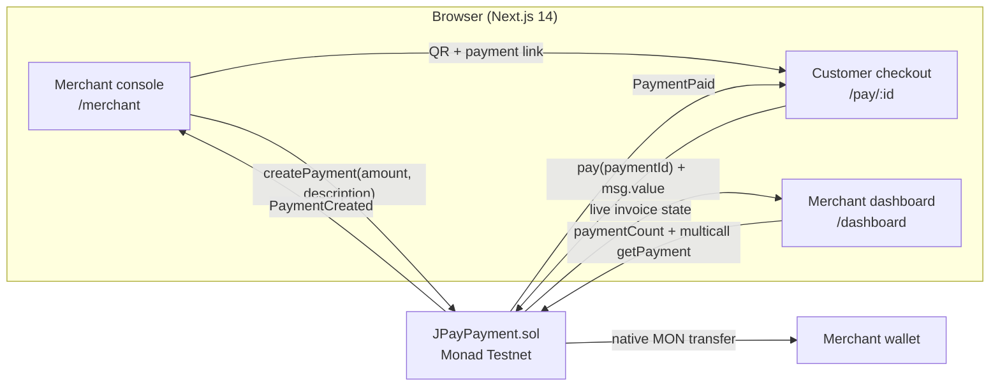

# JPay — Just Pay with Monad

**QR payments for local merchants in Yogyakarta. Non-custodial, settled on Monad.**

JPay lets a warung, coffee shop, or small store create an onchain invoice in
seconds, show a QR code, and receive native MON directly in its own wallet. The
customer does not need to install an app, and JPay never holds the money.

[Live demo](#live-demo) · [Demo flow](#demo-flow) · [Smart contract](#smart-contract) · [Run locally](#run-locally) · [Scoring checklist](docs/SCORING.md)

---

## The problem

Local merchants in Yogyakarta still rely on cash, manual bank transfers, and
screenshots of payment proofs. Crypto payments could remove friction, but most
tools are built for traders, not for a busy coffee counter:

- customers need a wallet, a network, and the right amount;
- funds often sit in a custodial app before reaching the merchant;
- settlement feels slow and the receipt is hard to verify;
- a generic wallet transfer is not a checkout experience.

## The solution

JPay is a mobile-first checkout built around one small, auditable contract:

1. The merchant creates an invoice with an amount and a description.
2. JPay turns it into a QR code and a shareable link.
3. The customer scans, reviews, and pays the exact amount in native MON.
4. The contract forwards MON straight to the merchant wallet and emits
   `PaymentPaid`.
5. The merchant dashboard updates live from onchain state — no backend, no
   indexer, no custody.

> **Positioning:** *Pay with crypto at any local merchant in Yogyakarta using
> Monad.*

---

## Live demo

| Item | Link |
| --- | --- |
| Live app | https://jpay.vercel.app |
| Demo video | _Add your 60–90 second video link_ |
| Social post | _Add your X/Twitter post link_ |
| Contract | [Monadscan](https://testnet.monadscan.com/address/0x654DDF8dc6e31C9e024E4009DBb3830b5E506E9a) |

The fastest judge-friendly entry point is **`/demo`**. It preloads a `1 MON`
invoice and includes the recording checklist.

---

## Features

| Area | What JPay does |
| --- | --- |
| Merchant checkout | Create an invoice with MON amount + description, then show QR/link |
| Customer checkout | Review amount, merchant, and description; pay exact MON onchain |
| Wallet options | Privy embedded wallet (email/Google), MetaMask, Coinbase, WalletConnect |
| Live status | Merchant screen and dashboard poll the contract every 4–5 seconds |
| Dashboard | Totals, pending/paid filters, payer address, tx links, auto-refresh |
| Non-custodial | `pay()` forwards MON directly to the merchant; JPay has no custody |
| Demo staging | `/demo`, `/merchant?demo=1`, and a **Load Demo Data** button |
| Loyalty | 10 JPay points per settled invoice, derived from onchain invoice data |
| Resilience | Wrong-network, insufficient-balance, rejected-transaction, and not-found states |
| Mobile-first | QR, copy, share, and wallet actions designed for a phone screen |

### Why Monad?

Monad gives the checkout the feel of a card tap: fast blocks, fast finality, and
EVM compatibility. JPay uses native MON, so there is no bridge, no token
approval, and no extra asset to explain to a merchant.

| Metric | Monad |
| --- | --- |
| Block time | ~400ms |
| Finality | ~800ms |
| Throughput | ~10,000 TPS |
| EVM | Compatible (Shanghai target for this contract) |

---

## Demo flow

Use two wallets: **A = merchant**, **B = customer**.

1. Open `/demo` and click **Open prefilled merchant**.
2. Connect wallet A on Monad Testnet. The form is already filled with
   `1 MON` and `Kopi Susu - Kedai Jogja`.
3. Click **Create payment** and approve the transaction. A QR and payment link
   appear.
4. Open the payment link in an incognito window or on your phone with wallet B.
5. Confirm the amount, description, merchant, and network.
6. Click **Pay 1 MON**, approve, and wait for the receipt.
7. The success screen shows the invoice ID, amount, merchant, payer, and tx hash.
8. Return to the merchant tab: the status changes to **Paid** within ~5 seconds.
9. Open `/dashboard`: the invoice is listed, totals update, and the merchant
   earns **10 JPay loyalty points**.
10. Open the tx hash on [Monadscan](https://testnet.monadscan.com) to verify it
    independently.

A presenter script, fallback plan, and test matrix are in
[`docs/DEMO.md`](docs/DEMO.md).

---

## Architecture



There is no server-side database. The contract is the source of truth, and the
frontend reads it with `wagmi`/`viem`. QR codes encode a normal URL, so any phone
camera works.

---

## Tech stack

| Layer | Tools |
| --- | --- |
| Frontend | Next.js 14 App Router, React 18, TypeScript |
| Styling | Tailwind CSS, custom dark design system (`#6E54FF`) |
| Auth + wallet | Privy (embedded wallet, email/Google), wagmi v2, viem |
| Data | TanStack Query, direct Monad RPC reads, viem multicall |
| Contract | Solidity `0.8.28`, Hardhat, ethers v6 |
| Network | Monad Testnet (`10143`), Monad Mainnet (`143`) metadata |
| Hosting | Vercel (Root Directory `apps/web`) |

---

## Monorepo structure

```text
jpay/
├── apps/
│   └── web/                    # Next.js frontend (@jpay/web)
│       ├── src/
│       │   ├── app/            # routes: /, /merchant, /pay/[id], /dashboard, /demo
│       │   ├── components/     # feature components + ui/ primitives
│       │   ├── config/         # chains, site metadata, demo preset
│       │   ├── lib/            # contract ABI, formatting, loyalty, wagmi
│       │   └── providers/      # Privy + wagmi + React Query
│       ├── public/
│       └── .env.example
├── packages/
│   └── contracts/              # Hardhat package (@jpay/contracts)
│       ├── contracts/JPayPayment.sol
│       ├── scripts/            # deploy + create-payment
│       ├── test/               # contract tests
│       ├── deployments/        # monadTestnet.json (address + ABI)
│       └── .env.example
├── docs/
│   ├── DEPLOY.md               # Vercel + Privy + post-deploy test
│   ├── DEMO.md                 # 3-minute script, checklist, backup plan
│   ├── VERIFY.md               # contract verification guide
│   └── SCORING.md              # 400-point submission checklist
├── scripts/healthcheck.mjs     # chain preflight (npm run check:chain)
├── package.json                # npm workspaces + root commands
└── README.md
```

---

## Smart contract

| Item | Value |
| --- | --- |
| Contract | `JPayPayment` |
| Network | Monad Testnet (`10143`) |
| Address | `0x654DDF8dc6e31C9e024E4009DBb3830b5E506E9a` |
| Explorer | https://testnet.monadscan.com/address/0x654DDF8dc6e31C9e024E4009DBb3830b5E506E9a |
| Deployer EOA | `0xad53015d98278C4c0EDEB3eDe0bE00D757Fa36a4` |
| Deployment tx | `0x7b92f7a9bf26a831c988cc7bdc4fb2f09b5b32421ccb58d21fafdf973f5bc207` |
| Source | [`packages/contracts/contracts/JPayPayment.sol`](packages/contracts/contracts/JPayPayment.sol) |
| Compiler | Solidity `0.8.28`, optimizer `200`, EVM `shanghai` |
| Verified | **Not yet** — see [`docs/VERIFY.md`](docs/VERIFY.md) |

> **Important:** `0xad53…36a4` is the **deployer wallet**, not the contract. It
> has no bytecode. JPay reads invoices from `0x654D…6E9a`.

### Contract API

| Function / event | Purpose |
| --- | --- |
| `createPayment(uint256 amount, string description)` | Merchant creates an invoice; returns `paymentId` starting at 1 |
| `pay(uint256 paymentId) payable` | Customer pays exactly `amount`; MON is forwarded to the merchant |
| `getPayment(uint256 paymentId)` | Read merchant, amount, description, status, payer, timestamp |
| `paymentCount()` | Number of invoices = latest payment ID |
| `PaymentCreated` | Emitted when an invoice is created |
| `PaymentPaid` | Emitted when an invoice is settled |

### Security properties

- Exact amount required — no overpay or underpay (`IncorrectAmount`).
- An invoice cannot be paid twice (`AlreadyPaid`).
- A merchant cannot pay their own invoice (`MerchantCannotPay`).
- Checks-effects-interactions before the MON transfer.
- No owner, no upgrade proxy, no custody. Funds flow customer → merchant.
- Custom errors keep gas low.
- Native MON only; USDC/ERC20 can be added as a separate contract later.

The contract is intentionally small and focused. It has not been audited; this is
a testnet MVP.

---

## Loyalty points

JPay includes a lightweight loyalty layer for the demo:

- **10 JPay points** are earned for every settled invoice.
- Points are derived from `getPayment` results already read by the dashboard —
  no extra transaction, no extra contract, no custody risk.
- The dashboard shows total points, and the merchant receipt shows the points
  earned by that invoice.
- A future version can move points onchain (event/counter) or add merchant
  rewards; the frontend API is isolated in `apps/web/src/lib/loyalty.ts`.

---

## Run locally

### Prerequisites

- Node.js **18.17+** and npm **9+**
- A [Privy](https://dashboard.privy.io) App ID
- Two Monad Testnet wallets with testnet MON
  ([faucet](https://faucet.monad.xyz))
- Git

### 1. Clone and install

```bash
git clone https://github.com/TestwayWeb3/jpay.git
cd jpay
npm install
```

This installs the npm workspaces (`apps/web` and `packages/contracts`).

### 2. Configure the frontend

```bash
# macOS / Linux
cp apps/web/.env.example apps/web/.env.local

# Windows PowerShell
Copy-Item apps/web/.env.example apps/web/.env.local
```

Fill in `apps/web/.env.local`:

```ini
NEXT_PUBLIC_PRIVY_APP_ID=your_privy_app_id
NEXT_PUBLIC_JPAY_PAYMENT_ADDRESS=0x654DDF8dc6e31C9e024E4009DBb3830b5E506E9a
```

Add `http://localhost:3000` to **Privy → Settings → Allowed origins**.

### 3. Start the app

```bash
npm run dev
```

Open http://localhost:3000.

### 4. Optional: contract environment

Only needed if you deploy or create invoices from the CLI:

```bash
cp packages/contracts/.env.example packages/contracts/.env
```

Then set `DEPLOYER_PRIVATE_KEY` in `packages/contracts/.env`. Never commit it.

### 5. Preflight

```bash
npm run check:chain
```

It reads `apps/web/.env.local`, checks the contract bytecode, reads
`paymentCount`, and prints the latest invoice. It ends with `✓ Ready to demo`
when the chain and address are correct.

---

## Environment variables

### Frontend (`apps/web/.env.local`)

| Variable | Required | Description |
| --- | --- | --- |
| `NEXT_PUBLIC_PRIVY_APP_ID` | **Yes** | Privy App ID; without it the app shows setup instructions |
| `NEXT_PUBLIC_JPAY_PAYMENT_ADDRESS` | **Yes** | Deployed JPayPayment address |
| `NEXT_PUBLIC_PRIVY_CLIENT_ID` | No | Only if your Privy project uses a client ID |
| `NEXT_PUBLIC_SITE_URL` | No | Canonical URL for metadata/OG; links use `window.location.origin` |
| `NEXT_PUBLIC_MONAD_TESTNET_RPC_URL` | No | Dedicated testnet RPC |
| `NEXT_PUBLIC_MONAD_RPC_URL` | No | Dedicated mainnet RPC |

`NEXT_PUBLIC_*` values are inlined at build time — redeploy after changing one.
Never put a private key in a `NEXT_PUBLIC_*` variable.

### Contracts (`packages/contracts/.env`)

| Variable | Required | Description |
| --- | --- | --- |
| `DEPLOYER_PRIVATE_KEY` | Deploy only | Testnet deployer private key; never commit |
| `MONAD_TESTNET_RPC_URL` | No | Defaults to `https://testnet-rpc.monad.xyz` |
| `MONAD_RPC_URL` | No | Defaults to `https://rpc.monad.xyz` |
| `JPAY_PAYMENT_ADDRESS` | No | Override address for `create-payment.ts` |
| `PAYMENT_AMOUNT` | No | Demo invoice amount for `create-payment.ts` |
| `PAYMENT_DESCRIPTION` | No | Demo invoice description |

---

## Available scripts

Run these from the repository root:

| Command | What it does |
| --- | --- |
| `npm run dev` | Start the Next.js dev server on `:3000` |
| `npm run build` | Production build of `apps/web` |
| `npm run start` | Start the production server |
| `npm run lint` | ESLint for the web app |
| `npm run typecheck` | `tsc --noEmit` for the web app |
| `npm run check:chain` | Contract bytecode + latest invoice preflight |
| `npm run contracts:compile` | Compile the Solidity contract |
| `npm run contracts:test` | Run the Hardhat test suite |
| `npm run contracts:deploy:testnet` | Deploy to Monad Testnet |
| `npm run contracts:create-payment:testnet` | Create a demo invoice from the CLI |

Do not run `typecheck` and `build` in parallel; they share the TypeScript build
cache and can collide.

---

## Deploy the frontend

Full instructions, including Privy origins and a production test script, are in
[`docs/DEPLOY.md`](docs/DEPLOY.md). The short version:

1. Push this repo to GitHub.
2. Import it in Vercel.
3. Set **Root Directory** to **`apps/web`**.
4. Add `NEXT_PUBLIC_PRIVY_APP_ID` and
   `NEXT_PUBLIC_JPAY_PAYMENT_ADDRESS` for Production and Preview.
5. Deploy, then add the Vercel origin to **Privy → Allowed origins**.
6. Re-test the two-wallet flow on the production URL.
7. Paste the production URL into the **Live demo** table above.

`apps/web/vercel.json` contains workspace-aware install/build commands; the Root
Directory setting is still required in the Vercel dashboard.

---

## Contract development

```bash
npm run contracts:compile
npm run contracts:test
```

To deploy a new testnet contract:

```bash
# packages/contracts/.env must contain DEPLOYER_PRIVATE_KEY
npm run contracts:deploy:testnet
```

The deploy script writes `packages/contracts/deployments/monadTestnet.json`
(address + ABI) and prints the `NEXT_PUBLIC_JPAY_PAYMENT_ADDRESS` line for
`apps/web/.env.local`.

Verification is documented in [`docs/VERIFY.md`](docs/VERIFY.md). The current
contract is deployed but not yet verified; verification does not change the
address or bytecode.

---

## Demo Video

> _Add your 60–90 second demo video here._

Suggested structure:

- **0:00–0:15** — Problem + Yogyakarta positioning.
- **0:15–0:40** — Merchant creates the prefilled invoice and shows the QR.
- **0:40–1:05** — Customer pays 1 MON; success receipt + tx hash.
- **1:05–1:25** — Dashboard flips to Paid, totals update, loyalty points appear.
- **1:25–1:40** — Non-custodial explanation + closing.

Recording tips: use `/demo`, open two browser profiles, hide bookmarks, and keep
the backup plan in [`docs/DEMO.md`](docs/DEMO.md) nearby.

## Social Proof

> _Add links after posting._

| Platform | Link | What it shows |
| --- | --- | --- |
| X / Twitter | _Add post URL_ | Demo video, screenshots, repo, contract |
| GitHub | https://github.com/TestwayWeb3/jpay | Source code |
| Monadscan | [Contract](https://testnet.monadscan.com/address/0x654DDF8dc6e31C9e024E4009DBb3830b5E506E9a) | Live contract |
| Vercel | _Add production URL_ | Live app |

Suggested post copy:

> JPay — QR payments for local merchants in Yogyakarta, settled on @monad.
> Customer scans, pays native MON, merchant receives it directly. No custody,
> no backend, no app install. Built with Next.js, Privy, wagmi & viem.
> #Monad #MonadBlitz

## Screenshots

Add these to `docs/screenshots/` before submission and reference them here:

| Screen | Suggested file |
| --- | --- |
| Landing page + Yogyakarta positioning | `docs/screenshots/landing.png` |
| Merchant invoice + QR | `docs/screenshots/merchant-qr.png` |
| Customer success receipt | `docs/screenshots/success.png` |
| Dashboard with Paid invoice + points | `docs/screenshots/dashboard.png` |
| Explorer transaction | `docs/screenshots/explorer.png` |

The demo flow above is the fallback if screenshots are not ready yet.

---

## Submission checklist

The full 400-point checklist, manual actions, and evidence table are in
[`docs/SCORING.md`](docs/SCORING.md). The highest-impact manual items are:

- [ ] Deploy to Vercel (`apps/web`) and add the live URL.
- [ ] Verify the contract and add the explorer link.
- [ ] Record and upload the demo video.
- [ ] Post on X and add the social link.
- [ ] Add screenshots.

---

## Limitations & roadmap

- Monad Testnet only for the demo; mainnet metadata is ready but not deployed.
- Native MON only; USDC/ERC20 settlement is a future contract.
- No refunds or disputes yet; the contract is intentionally minimal.
- Loyalty points are frontend-derived, not a separate onchain token.
- No indexer; dashboard multicalls the latest 100 invoices. Fine for a demo,
  and an indexer can be added later for analytics.
- Contract is not audited. Use a dedicated testnet deployer wallet.

Roadmap: merchant profiles, onchain loyalty events, USDC settlement, receipt
NFTs, and a lightweight indexer for merchant analytics.

---

## Acknowledgements

Built for **Monad Blitz** with [Monad](https://monad.xyz),
[Privy](https://privy.io), [wagmi](https://wagmi.sh),
[viem](https://viem.sh), [Next.js](https://nextjs.org), and
[Tailwind CSS](https://tailwindcss.com).

Contract source is MIT-licensed (`SPDX-License-Identifier: MIT`).
